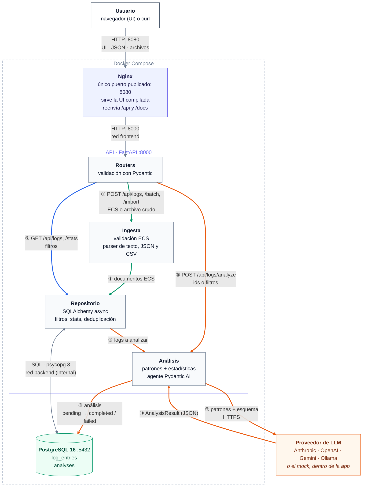
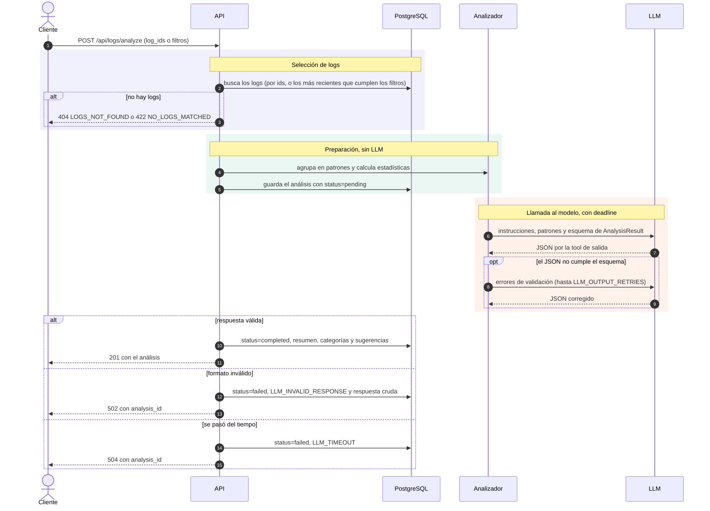
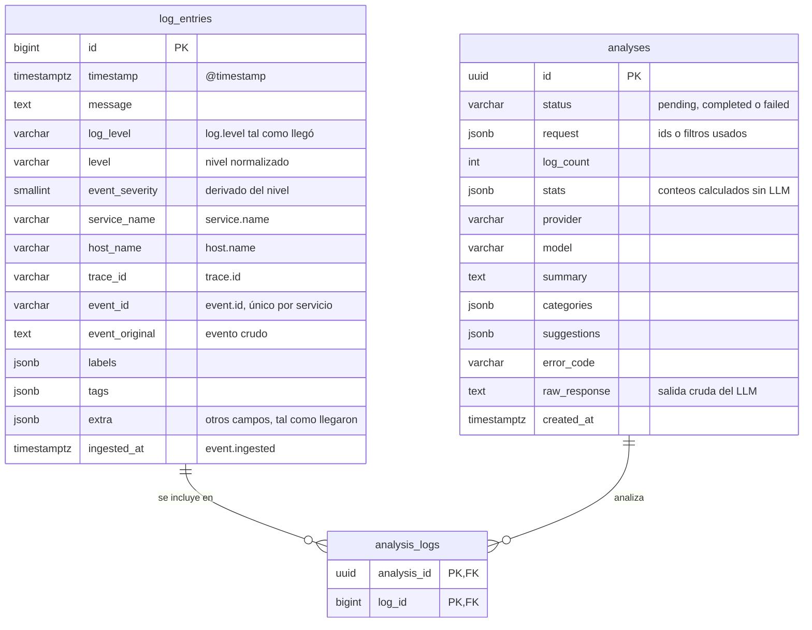

# Arquitectura - SmartLog Analyzer

Prototipo de una herramienta interna que recibe logs de varios microservicios, los guarda y usa un LLM para detectar patrones y proponer acciones.

## 1. Vista general

Componentes, cómo se comunican (protocolo, puerto y red de Docker) y los tres flujos de datos: **① ingesta** (verde), **② consulta** (azul) y **③ análisis** (naranja).



### Componentes y comunicación

| Componente | Qué hace | Se comunica con |
|---|---|---|
| **Usuario** | Usa la UI web en el navegador, o la API directamente con `curl` o un script. | Nginx, por HTTP en el puerto 8080. Es la única entrada al sistema. |
| **Nginx** | Sirve la UI compilada (React) en `/`. Reenvía `/api`, `/docs` y `/openapi.json` a la API. Limita el tamaño de los requests (5 MB) y la tasa de requests a la API, y le da más tiempo a `/api/logs/analyze` (90 s). | La API, por HTTP en el puerto 8000, en la red `frontend`. |
| **API (FastAPI)** | Valida cada request con Pydantic y la resuelve con sus capas internas: ingesta, repositorio y análisis. Responde JSON con un formato de error único. | PostgreSQL, por SQL con psycopg 3 async, en la red `backend`. El proveedor de LLM, por HTTPS saliente. |
| **PostgreSQL 16** | Guarda los logs (`log_entries`) y los análisis (`analyses` y `analysis_logs`). | Solo la API. Está en la red `backend`, marcada `internal`, sin puerto publicado ni salida a internet. |
| **Proveedor de LLM** | Recibe los patrones ya agrupados y devuelve el análisis como JSON validado contra `AnalysisResult`. | La API, por HTTPS, con timeout y un reintento. Con `LLM_PROVIDER=mock`, el modelo corre dentro de la API y no sale nada a la red. |

### Flujo de datos

| Flujo | Recorrido |
|---|---|
| **① Ingesta** | El usuario envía un documento ECS (`POST /api/logs`), un lote (`/batch`) o un archivo crudo de texto, JSON o CSV (`/import`). La ingesta parsea el archivo, lo normaliza a ECS y valida cada registro por separado. El repositorio inserta los válidos en `log_entries` con `ON CONFLICT DO NOTHING`, así los `event.id` repetidos no se duplican. La API responde con los ids guardados y los errores de cada registro. |
| **② Consulta** | El usuario pide `GET /api/logs` (listado paginado) o `/api/logs/stats` (conteos por servicio, nivel, host o período) con filtros ECS. El repositorio traduce los filtros a SQL sobre los índices de `log_entries` y la API devuelve documentos ECS o buckets agregados. |
| **③ Análisis** | El usuario pide `POST /api/logs/analyze` con ids o con filtros. La API carga esos logs, los agrupa en patrones con estadísticas (sin LLM) y guarda el análisis como `pending`. Después envía al LLM los patrones y el esquema `AnalysisResult`. La respuesta se valida, y el análisis queda `completed` con resumen, categorías y sugerencias, o `failed` con el código de error. El detalle paso a paso está en el diagrama de secuencia de abajo. |

Redes de Docker: `frontend` (nginx y app) y `backend` (app y db, marcada `internal`). La base de datos no queda expuesta fuera de Compose; el único puerto publicado es el de Nginx. La app también está en `frontend` porque necesita salida a internet para llegar al proveedor de LLM.

### Flujo de un análisis



### Componentes

Estructura del repositorio. El backend sigue capas: los `routers` reciben HTTP, los `services` coordinan los casos de uso, `repositories` habla con la base y `domain` tiene la lógica pura, que se testea sin base ni red.

```text
smartlog-analyzer/
├── src/
│   ├── api/               # backend: paquete Python `api` (FastAPI)
│   │   ├── main.py
│   │   ├── routers/       # endpoints HTTP: traducen HTTP a llamadas de servicio
│   │   │   ├── logs.py
│   │   │   ├── analysis.py
│   │   │   ├── health.py
│   │   │   └── deps.py
│   │   ├── schemas/       # validación de entrada y contratos de salida (Pydantic)
│   │   │   ├── logs.py
│   │   │   ├── analysis.py
│   │   │   ├── health.py
│   │   │   └── common.py
│   │   ├── services/      # casos de uso
│   │   │   ├── ingestion.py
│   │   │   └── analysis.py
│   │   ├── repositories/  # acceso a datos: filtros, agregaciones, inserts idempotentes
│   │   │   └── logs.py
│   │   ├── domain/        # lógica pura, sin I/O
│   │   │   ├── ecs.py
│   │   │   ├── patterns.py
│   │   │   └── raw_logs/  # logs crudos en cualquier esquema → ECS
│   │   │       ├── files.py
│   │   │       ├── text.py
│   │   │       ├── profiles.py
│   │   │       ├── normalize.py
│   │   │       └── timestamps.py
│   │   ├── llm/           # integración con el LLM (Pydantic AI)
│   │   │   ├── agent.py
│   │   │   ├── prompt.py
│   │   │   ├── analyzer.py
│   │   │   ├── providers.py
│   │   │   └── mock.py
│   │   ├── database/      # engine, sesión async y modelos ORM
│   │   │   ├── session.py
│   │   │   └── tables.py
│   │   └── core/          # settings, errores y logging
│   │       ├── config.py
│   │       ├── errors.py
│   │       └── logging.py
│   └── frontend/          # interfaz web (React + Vite + TypeScript)
│       ├── src/api/
│       ├── src/pages/
│       ├── src/components/
│       ├── src/lib/
│       └── vite.config.ts
├── db/                    # migraciones de Alembic y datos de ejemplo
│   ├── migrations/versions/
│   └── seed.py
├── tests/                 # unitarios e integración contra PostgreSQL
│   ├── unit/
│   └── integration/
├── docker/                # imagen de nginx con la UI y arranque de la API
│   ├── nginx.Dockerfile
│   ├── nginx.conf
│   └── entrypoint.sh
├── docs/openapi.json
├── Dockerfile
├── docker-compose.yml
└── Makefile
```

Las dependencias van hacia adentro, nunca al revés:
- `routers` usa `services` para los casos de uso con varios pasos (ingesta en lote, importación, análisis) y llama a `repositories` directamente para las consultas simples (listado, stats, un log).
- `services` usa `repositories` y `llm`; `llm` usa `domain` para agrupar los logs en patrones antes de llamar al modelo.
- `domain` solo usa la biblioteca estándar: no importa nada de HTTP, de la base de datos ni del LLM.

## 2. Modelo de datos



El diagrama muestra las columnas principales. `log_entries` tiene además columnas tipadas para `service.version`, `service.environment`, `log.logger`, `span.id`, `transaction.id`, `error.type`, `error.message`, `error.stack_trace`, `event.dataset` y `ecs.version`. `analyses` guarda también `pattern_count`, `error_message`, `duration_ms` y `completed_at`. La definición completa está en [src/api/database/tables.py](src/api/database/tables.py).

Cada columna corresponde a un campo ECS, y la API reconstruye el documento ECS anidado a partir de ellas. Los campos ECS más usados para filtrar y agregar son columnas tipadas; el resto se guarda en `extra` (JSONB) y se devuelve tal como llegó.

Índices de `log_entries`: `(timestamp)`, `(service_name, timestamp)` y `(level, timestamp)` para los filtros habituales, que siempre llevan una ventana de tiempo; uno parcial sobre `trace_id IS NOT NULL`; uno único y parcial sobre `(service_name, event_id)` para que los reintentos no dupliquen logs; y un GIN con `pg_trgm` sobre `message` para la búsqueda de texto (`q`).

Consulta de agregación (`GET /api/logs/stats`): `COUNT`, `MIN` y `MAX` agrupados por cualquier combinación de `service.name`, nivel normalizado, `service.environment`, `host.name` y periodo (`date_trunc('hour'|'day')`), con los mismos filtros que el listado.

Migraciones: `0001` crea el esquema inicial; `0002` lo lleva a ECS convirtiendo los datos existentes (renombra columnas, guarda el nivel original y deriva el normalizado y `event.severity`); `0003` agrega `event_id` y los índices de deduplicación y de búsqueda. Todas tienen `downgrade`, y los tests verifican la conversión de datos de `0002` y la ida y vuelta de `0003`.

## 3. Decisiones técnicas

Para cada decisión: qué elegí, qué alternativa descarté y por qué.

### 3.1 Lenguaje y framework: Python + FastAPI
- **Descartado:** Node.js con NestJS o Express, y Django REST Framework.
- **Por qué:** FastAPI genera la validación y el OpenAPI a partir de los mismos modelos Pydantic, así que el contrato de la API y su documentación no se desalinean. Es async, lo que importa porque un análisis espera varios segundos al LLM sin bloquear al resto. Python además tiene el ecosistema de IA más maduro. Django aporta admin y un ORM sincrónico que acá no hacen falta.

### 3.2 Base de datos: PostgreSQL
- **Descartado:** MongoDB, Elasticsearch/OpenSearch y SQLite.
- **Por qué:** los logs tienen una parte fija (timestamp, servicio, nivel, mensaje) y una parte variable. PostgreSQL cubre las dos: columnas tipadas con índices para filtrar y agregar, más `JSONB` para `attributes` y para los resultados del LLM. Las agregaciones por tiempo salen directo con `date_trunc`, y la relación análisis-logs es relacional por naturaleza.
  - **MongoDB:** daría flexibilidad que ya cubre `JSONB`, a costa de perder integridad referencial y de hacer más incómodas las agregaciones.
  - **OpenSearch:** es la opción correcta para millones de logs por día y búsqueda full-text avanzada, pero es mucho más pesado de operar para un prototipo. El repositorio aísla el acceso a datos, así que migrar después es acotado.
  - **SQLite:** no tiene `JSONB`, `date_trunc` ni concurrencia real de escritura.

### 3.3 Acceso a datos: SQLAlchemy 2 (async) + Alembic, con psycopg 3
- **Descartado:** SQL a mano, SQLModel, y asyncpg con otro driver para las migraciones.
- **Por qué:** SQLAlchemy permite construir filtros dinámicos de forma segura (sin concatenar SQL) y Alembic versiona el esquema con `upgrade` y `downgrade`. psycopg 3 funciona en modo async (para la app) y sync (para Alembic y el seed) con la misma `DATABASE_URL`. Un test verifica que la migración coincide con los modelos.

### 3.4 Preprocesar los logs antes del LLM (patrones + estadísticas)
- **Descartado:** mandar los logs crudos al modelo, y usar la librería Drain3.
- **Por qué:** 500 logs crudos son repetitivos, caros en tokens y fáciles de truncar. Agrupándolos en plantillas (`Could not acquire DB connection after <NUM>`) con conteo, servicios, ventana temporal e ids de ejemplo, 500 líneas suelen quedar en 10 a 50 patrones. Los conteos se calculan en código porque los LLM cuentan mal; el modelo solo interpreta. Drain3 es más robusto con logs sin estructura, pero para el prototipo alcanza con máscaras regex ordenadas y sin dependencias. Sería el siguiente paso si la calidad de los patrones no alcanza.

### 3.5 Pydantic AI como capa de LLM + mock realista
- **Descartado:** llamar al SDK directamente desde el endpoint, una interfaz de proveedor propia con un parser de JSON a mano, y un mock que devuelve siempre la misma respuesta fija.
- **Por qué:** un único `Agent` de Pydantic AI (`src/api/llm/agent.py`) define instrucciones, tipo de salida y dependencias; el modelo se elige en tiempo de ejecución (`pydantic_ai.models.Model`). Validación, reintentos y timeout se resuelven una sola vez, igual para todos los modelos. Cambiar de proveedor es un cambio de variable de entorno, y agregar uno nuevo es una función en `src/api/llm/providers.py`, porque Pydantic AI ya los implementa. El mock es un `FunctionModel` que aplica reglas sobre los patrones reales y responde por la misma tool de salida: la demo funciona sin API key, sus resultados reflejan los datos y pasa por la misma validación. Los tests usan `FunctionModel` para simular respuestas, demoras y errores.

### 3.6 Salida estructurada validada con Pydantic
- **Descartado:** pedir JSON en el prompt y parsear texto libre.
- **Por qué:** con `output_type=AnalysisResult`, Pydantic AI le envía al modelo el JSON Schema del modelo Pydantic como tool de salida (las `description` de los campos funcionan como instrucciones) y valida la respuesta: enums de severidad y prioridad, campos obligatorios y enteros no negativos. Si no cumple, le devuelve los errores de validación al modelo y reintenta (`LLM_OUTPUT_RETRIES`, por defecto 1); si sigue fallando, es `LLM_INVALID_RESPONSE` con el detalle de los campos. Un `output_validator` con las dependencias del run descarta los `example_log_ids` que no pertenecen al análisis (protección contra alucinaciones).

### 3.7 Análisis sincrónico con deadline, persistido como `pending` antes de llamar al LLM
- **Descartado:** una cola (Celery/RQ con Redis, o SQS) con worker y polling.
- **Por qué:** para un prototipo, una respuesta directa en un solo request es más simple de usar y de probar, y el timeout (`LLM_TIMEOUT_SECONDS`, cancelación real con el `timeout` de `Agent.run`) acota la espera. El registro se guarda como `pending` antes de llamar al modelo y `GET /api/analysis/{id}` ya existe, así que pasar a procesamiento en segundo plano solo cambia quién ejecuta `run()`: el endpoint devolvería `202` con el id. Es el primer cambio que haría si los análisis superan unos 30 segundos o si hay mucha concurrencia.

### 3.8 Los fallos del LLM también se persisten
- **Descartado:** devolver el error sin guardar nada, o responder `200` con `status: failed`.
- **Por qué:** un análisis fallido es información (qué se pidió, qué devolvió el modelo, cuánto tardó). Se guarda con `status=failed`, `error_code` y `raw_response`, y el cuerpo del error incluye el `analysis_id`. El código HTTP refleja la semántica real: `502` si el proveedor responde mal o falla, y `504` si no responde a tiempo.

### 3.9 Formato de error único
- **Descartado:** el formato por defecto de FastAPI (`{"detail": ...}`), que cambia según el tipo de error.
- **Por qué:** todos los errores (validación, 404, 405, de dominio, del LLM e inesperados) devuelven `{"error": {"code", "message", "details?"}, "request_id"}`. Un cliente puede ramificar por `code` sin parsear mensajes. Los errores `500` nunca exponen detalles internos.

### 3.10 Paginación limit/offset
- **Descartado:** paginación por cursor (keyset).
- **Por qué:** limit/offset es simple de entender y de usar desde una UI, y alcanza para el volumen de un prototipo. Con tablas grandes conviene keyset sobre `(timestamp, id)`, que ya está indexado y ordenado así.

### 3.11 Tests contra PostgreSQL real
- **Descartado:** SQLite en memoria para los tests de integración.
- **Por qué:** `JSONB`, `date_trunc`, `ILIKE ... ESCAPE` y los `CHECK` se comportan distinto en SQLite, así que los tests pasarían sin probar lo que corre en producción. La base de tests se migra con Alembic una vez por sesión (lo que también prueba las migraciones) y se trunca antes de cada test. Los tests unitarios (patrones, esquemas, analizador con modelos simulados) no necesitan base de datos.

### 3.12 Nginx como reverse proxy
- **Descartado:** exponer Uvicorn directamente.
- **Por qué:** da un único punto de entrada, límite de tamaño de body, rate limiting básico y un timeout más largo solo para `/analyze`. Además conserva o genera un `X-Request-ID` que la app propaga a sus logs y a las respuestas.

### 3.13 Logs de la propia app en JSON
- **Descartado:** el formato de texto por defecto de Uvicorn.
- **Por qué:** la herramienta analiza logs, así que los suyos siguen el formato que recomienda: una línea JSON por evento con `request_id`, ruta, status y duración.

### 3.14 Formato de los logs: Elastic Common Schema (ECS)
- **Descartado:** un formato propio (`service`, `level`, `attributes`), aceptar varios formatos en el mismo endpoint, y OpenTelemetry (OTLP) como formato principal.
- **Por qué:** ECS es un estándar abierto con librerías oficiales (*ecs-logging*) para los lenguajes más comunes, así que muchos servicios ya pueden emitir este formato sin código propio, y los nombres de campo (`service.name`, `trace.id`, `error.stack_trace`) son los que el equipo ya conoce de Elastic, Kibana o Filebeat. Un único formato canónico mantiene una sola ruta de validación; otras fuentes (CloudWatch, Azure, texto plano) se adaptan en el borde, en el shipper o en un adaptador. OTLP es la otra opción fuerte y además se alinea con ECS (las dos convenciones se están unificando), pero su payload es más verboso para enviar a mano y para un prototipo; quedaría como segundo endpoint.

Decisiones dentro de ECS:
- **Entrada:** se aceptan claves con puntos y objetos anidados, porque las librerías *ecs-logging* emiten `"log.level"` con puntos y ECS recomienda anidar. La salida siempre es anidada. Si el mismo campo llega dos veces con valores distintos, se rechaza.
- **`log.level`:** ECS lo define como el nivel **original** de la fuente, así que se guarda tal cual. Para filtrar y analizar de forma uniforme se derivan un nivel normalizado (`critical`, `error`, `warn`, `info`, `debug`) y `event.severity` con códigos de syslog. ECS deja el significado de `event.severity` al implementador.
  - Se rechazan niveles desconocidos en vez de aceptarlos sin severidad: un nivel mal escrito haría que un error desapareciera de los filtros y del análisis.
  - Descartado: guardar solo el nivel normalizado, porque pierde el valor original que ECS pide conservar.
- **Campos permisivos:** ECS admite campos adicionales, así que se guardan en `extra` (JSONB) y se devuelven tal como llegaron. El costo es que un error de tipeo en un campo opcional no se detecta; los campos obligatorios sí se validan.
- **Campos del pipeline:** `event.ingested` y `event.severity` los pone SmartLog y se ignoran si vienen del cliente.

## 4. Integración real con un LLM

Los modelos reales se arman en `src/api/llm/providers.py`, uno por proveedor:

| `LLM_PROVIDER` | Modelo de Pydantic AI | Cliente |
|---|---|---|
| `anthropic` | `AnthropicModel` | `anthropic.AsyncAnthropic` |
| `openai` | `OpenAIChatModel` | `openai.AsyncOpenAI`; `LLM_BASE_URL` apunta a cualquier API compatible |
| `google` | `GoogleModel` | `google-genai`, Gemini Developer API |
| `ollama` | `OllamaModel` | `openai.AsyncOpenAI` contra Ollama (`http://localhost:11434/v1` por defecto) |

Por ejemplo, con Anthropic:

```env
LLM_PROVIDER=anthropic
LLM_API_KEY=sk-ant-...
LLM_MODEL=claude-haiku-5-5   # o cualquier modelo disponible en la cuenta
LLM_TIMEOUT_SECONDS=30
```

Detalles comunes a todos:
- Usan `temperature=0`, para análisis más estables entre ejecuciones.
- Tienen un timeout en el SDK (`LLM_TIMEOUT_SECONDS`, y un solo reintento) como segunda red de seguridad, además del deadline del run del agente. Google toma el timeout del cliente HTTP.
- Los timeouts del proveedor se traducen a `LLM_TIMEOUT`, y los errores HTTP (429, 5xx) a `LLM_PROVIDER_ERROR`: el analizador usa las excepciones de Pydantic AI, que son las mismas para todos los proveedores.
- `raw_response` guarda lo que dijo el modelo (texto y argumentos de la tool de salida, de todos los intentos), y el log de la app registra los tokens usados.
- Los SDK se importan solo cuando se usa ese proveedor. Si falta uno, el arranque falla con un mensaje que dice qué instalar.
- Con Ollama, el modelo tiene que soportar tool calling (la salida estructurada viaja como tool).

Para agregar otro proveedor que Pydantic AI soporte, se instala su extra, se agrega una función `_<proveedor>(settings, http_client)` en `providers.py`, se la registra en `_BUILDERS` y se suma el valor al `Literal` de `llm_provider` en `core/config.py`.

El resto (agente, prompt, validación, timeout, persistencia y tests) no cambia.

**Prompt injection:** los mensajes de log son datos no confiables. El prompt los delimita dentro de `<log_data>` y le indica al modelo que ignore instrucciones dentro de ese bloque. Además, la salida solo se acepta si cumple el esquema de `AnalysisResult`.

## 5. Limitaciones y próximos pasos

Ver [Pendientes en el README](README.md#pendientes).
