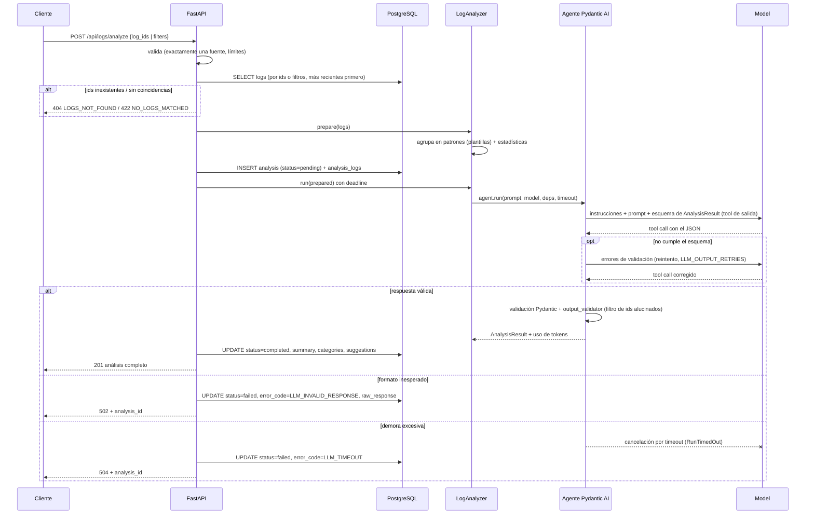
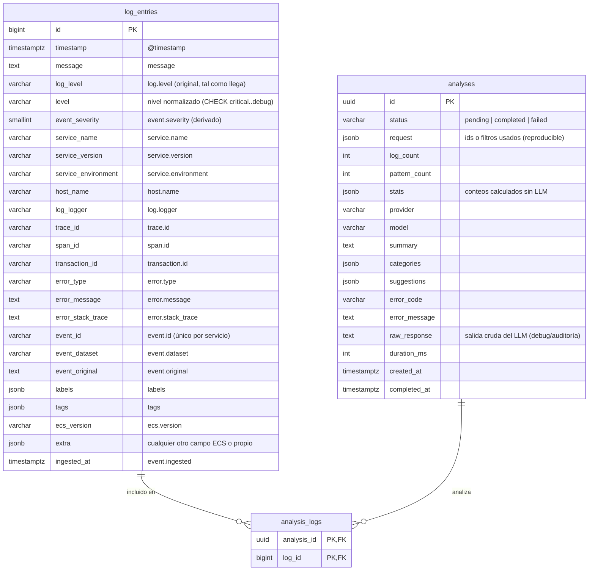

# Arquitectura - SmartLog Analyzer

Prototipo de una herramienta interna que recibe logs de varios microservicios, los guarda y usa un LLM para detectar patrones y proponer acciones.

## 1. Vista general

```mermaid
flowchart LR
    subgraph Productores
        MS1[orders-api]
        MS2[payments-api]
        MS3[auth-service]
        DEV[Ingeniero / UI / curl]
    end

    subgraph Docker Compose
        NGINX[Nginx :8080<br/>UI estática en /<br/>reverse proxy de /api]

        subgraph API [FastAPI app :8000]
            R[Routers<br/>validación Pydantic]
            S[Servicios<br/>LogRepository<br/>AnalysisService]
            P[Preprocesamiento<br/>patrones + estadísticas]
            L[LogAnalyzer<br/>preparación, deadline, errores]
            G[Agente Pydantic AI<br/>output_type=AnalysisResult]
            I{{pydantic_ai Model}}
            M[MockModel<br/>FunctionModel]
            A[AnthropicModel]
        end

        DB[(PostgreSQL 16<br/>log_entries<br/>analyses<br/>analysis_logs)]
    end

    CLAUDE[(API de Anthropic)]

    MS1 & MS2 & MS3 -- "POST /api/logs(/batch)<br/>documentos ECS" --> NGINX
    DEV -- "GET /api/logs, /stats<br/>POST /analyze<br/>GET /api/analysis/{id}" --> NGINX
    NGINX --> R --> S
    S <--> DB
    S --> P --> L --> G --> I
    I -.-> M
    I -.-> A -- HTTPS --> CLAUDE
```



Redes de Docker: `frontend` (nginx y app) y `backend` (app y db, marcada `internal`). La base de datos no queda expuesta fuera de Compose; el único puerto publicado es el de Nginx.

### Flujo de un análisis



### Componentes

| Componente | Responsabilidad |
|---|---|
| `src/frontend/` | Interfaz web (React + Vite + TypeScript). Cliente tipado con los tipos generados desde el OpenAPI; Nginx sirve el build en el mismo origen que la API. |
| `src/api/routers/` | Endpoints HTTP. Solo traducen HTTP a llamadas de servicio. |
| `src/api/schemas/` | Toda la validación de entrada y los contratos de salida, por recurso: `logs.py`, `analysis.py` (incluido el contrato que debe cumplir el LLM), `health.py` y tipos compartidos en `common.py`. |
| `src/api/core/` | Settings (`config.py`), errores de dominio y el formato único de error (`errors.py`), logging JSON (`logging.py`). |
| `src/api/database/` | Engine y sesión async (`session.py`) y modelos ORM (`tables.py`). |
| `src/api/domain/ecs.py` | Convenciones ECS: niveles, claves con puntos y anidadas. |
| `src/api/repositories/logs.py` | Acceso a datos de logs y la consulta de agregación. |
| `src/api/domain/patterns.py` | Preprocesamiento determinístico: plantillas y estadísticas. |
| `src/api/services/analysis.py` | Caso de uso de análisis: selecciona logs, llama al analizador y persiste el resultado o el fallo. |
| `src/api/llm/` | Agente de Pydantic AI (`agent.py`), prompt, `LogAnalyzer` (deadline y mapeo de errores), selección del modelo (`providers.py`) y el mock como `FunctionModel` (`mock.py`). |
| `db/migrations/` | Migraciones versionadas (Alembic). |
| `db/seed.py` | Datos de ejemplo con incidentes reales para que el análisis tenga algo que encontrar. |

## 2. Modelo de datos



Cada columna corresponde a un campo ECS, y la API reconstruye el documento ECS anidado a partir de ellas. Los campos ECS más usados para filtrar y agregar son columnas tipadas; el resto se guarda en `extra` (JSONB) y se devuelve tal como llegó.

Índices de `log_entries`: `(timestamp)`, `(service_name, timestamp)`, `(level, timestamp)` y un índice parcial sobre `trace_id IS NOT NULL`. Cubren los filtros habituales, que siempre llevan una ventana de tiempo.

Consulta de agregación (`GET /api/logs/stats`): `COUNT`, `MIN` y `MAX` agrupados por cualquier combinación de `service.name`, nivel normalizado, `service.environment`, `host.name` y periodo (`date_trunc('hour'|'day')`), con los mismos filtros que el listado.

Migraciones: `0001` crea el esquema inicial y `0002` lo lleva a ECS convirtiendo los datos existentes (renombra columnas, guarda el nivel original y deriva el normalizado y `event.severity`). Las dos tienen `downgrade`, y un test verifica la conversión de datos en ambos sentidos.

## 3. Decisiones técnicas

Para cada decisión: qué elegí, qué alternativa descarté y por qué.

### 3.1 Lenguaje y framework: Python + FastAPI
- **Descartado:** Node.js con NestJS o Express, y Django REST Framework.
- **Por qué:** FastAPI genera la validación y el OpenAPI a partir de los mismos modelos Pydantic, así que el contrato de la API y su documentación no se desalinean. Es async, lo que importa porque un análisis espera varios segundos al LLM sin bloquear al resto. Python además tiene el ecosistema de IA más maduro. Django aporta admin y un ORM sincrónico que acá no hacen falta.

### 3.2 Base de datos: PostgreSQL
- **Descartado:** MongoDB, Elasticsearch/OpenSearch y SQLite.
- **Por qué:** los logs tienen una parte fija (timestamp, servicio, nivel, mensaje) y una parte variable. PostgreSQL cubre las dos: columnas tipadas con índices para filtrar y agregar, más `JSONB` para `attributes` y para los resultados del LLM. Las agregaciones por tiempo salen directo con `date_trunc`, y la relación análisis-logs es relacional por naturaleza.
  - **MongoDB:** daría flexibilidad que ya cubre `JSONB`, a costa de perder integridad referencial y de hacer más incómodas las agregaciones.
  - **OpenSearch:** es la opción correcta para millones de logs por día y búsqueda full-text avanzada, pero es mucho más pesado de operar para un prototipo. El repositorio aísla el acceso a datos, así que migrar después es acotado.
  - **SQLite:** no tiene `JSONB`, `date_trunc` ni concurrencia real de escritura.

### 3.3 Acceso a datos: SQLAlchemy 2 (async) + Alembic, con psycopg 3
- **Descartado:** SQL a mano, SQLModel, y asyncpg con otro driver para las migraciones.
- **Por qué:** SQLAlchemy permite construir filtros dinámicos de forma segura (sin concatenar SQL) y Alembic versiona el esquema con `upgrade` y `downgrade`. psycopg 3 funciona en modo async (para la app) y sync (para Alembic y el seed) con la misma `DATABASE_URL`. Un test verifica que la migración coincide con los modelos.

### 3.4 Preprocesar los logs antes del LLM (patrones + estadísticas)
- **Descartado:** mandar los logs crudos al modelo, y usar la librería Drain3.
- **Por qué:** 500 logs crudos son repetitivos, caros en tokens y fáciles de truncar. Agrupándolos en plantillas (`Could not acquire DB connection after <NUM>`) con conteo, servicios, ventana temporal e ids de ejemplo, 500 líneas suelen quedar en 10 a 50 patrones. Los conteos se calculan en código porque los LLM cuentan mal; el modelo solo interpreta. Drain3 es más robusto con logs sin estructura, pero para el prototipo alcanza con máscaras regex ordenadas y sin dependencias. Sería el siguiente paso si la calidad de los patrones no alcanza.

### 3.5 Pydantic AI como capa de LLM + mock realista
- **Descartado:** llamar al SDK directamente desde el endpoint, una interfaz de proveedor propia con un parser de JSON a mano, y un mock que devuelve siempre la misma respuesta fija.
- **Por qué:** un único `Agent` de Pydantic AI (`src/api/llm/agent.py`) define instrucciones, tipo de salida y dependencias; el modelo se elige en tiempo de ejecución (`pydantic_ai.models.Model`). Validación, reintentos y timeout se resuelven una sola vez, igual para todos los modelos. Cambiar de proveedor es un cambio de variable de entorno, y agregar uno nuevo es una función en `src/api/llm/providers.py`, porque Pydantic AI ya los implementa. El mock es un `FunctionModel` que aplica reglas sobre los patrones reales y responde por la misma tool de salida: la demo funciona sin API key, sus resultados reflejan los datos y pasa por la misma validación. Los tests usan `FunctionModel` para simular respuestas, demoras y errores.

### 3.6 Salida estructurada validada con Pydantic
- **Descartado:** pedir JSON en el prompt y parsear texto libre.
- **Por qué:** con `output_type=AnalysisResult`, Pydantic AI le envía al modelo el JSON Schema del modelo Pydantic como tool de salida (las `description` de los campos funcionan como instrucciones) y valida la respuesta: enums de severidad y prioridad, campos obligatorios y enteros no negativos. Si no cumple, le devuelve los errores de validación al modelo y reintenta (`LLM_OUTPUT_RETRIES`, por defecto 1); si sigue fallando, es `LLM_INVALID_RESPONSE` con el detalle de los campos. Un `output_validator` con las dependencias del run descarta los `example_log_ids` que no pertenecen al análisis (protección contra alucinaciones).

### 3.7 Análisis sincrónico con deadline, persistido como `pending` antes de llamar al LLM
- **Descartado:** una cola (Celery/RQ con Redis, o SQS) con worker y polling.
- **Por qué:** para un prototipo, una respuesta directa en un solo request es más simple de usar y de probar, y el timeout (`LLM_TIMEOUT_SECONDS`, cancelación real con el `timeout` de `Agent.run`) acota la espera. El registro se guarda como `pending` antes de llamar al modelo y `GET /api/analysis/{id}` ya existe, así que pasar a procesamiento en segundo plano solo cambia quién ejecuta `run()`: el endpoint devolvería `202` con el id. Es el primer cambio que haría si los análisis superan unos 30 segundos o si hay mucha concurrencia.

### 3.8 Los fallos del LLM también se persisten
- **Descartado:** devolver el error sin guardar nada, o responder `200` con `status: failed`.
- **Por qué:** un análisis fallido es información (qué se pidió, qué devolvió el modelo, cuánto tardó). Se guarda con `status=failed`, `error_code` y `raw_response`, y el cuerpo del error incluye el `analysis_id`. El código HTTP refleja la semántica real: `502` si el proveedor responde mal o falla, y `504` si no responde a tiempo.

### 3.9 Formato de error único
- **Descartado:** el formato por defecto de FastAPI (`{"detail": ...}`), que cambia según el tipo de error.
- **Por qué:** todos los errores (validación, 404, 405, de dominio, del LLM e inesperados) devuelven `{"error": {"code", "message", "details?"}, "request_id"}`. Un cliente puede ramificar por `code` sin parsear mensajes. Los errores `500` nunca exponen detalles internos.

### 3.10 Paginación limit/offset
- **Descartado:** paginación por cursor (keyset).
- **Por qué:** limit/offset es simple de entender y de usar desde una UI, y alcanza para el volumen de un prototipo. Con tablas grandes conviene keyset sobre `(timestamp, id)`, que ya está indexado y ordenado así.

### 3.11 Tests contra PostgreSQL real
- **Descartado:** SQLite en memoria para los tests de integración.
- **Por qué:** `JSONB`, `date_trunc`, `ILIKE ... ESCAPE` y los `CHECK` se comportan distinto en SQLite, así que los tests pasarían sin probar lo que corre en producción. La base de tests se migra con Alembic una vez por sesión (lo que también prueba las migraciones) y se trunca antes de cada test. Los tests unitarios (patrones, esquemas, analizador con modelos simulados) no necesitan base de datos.

### 3.12 Nginx como reverse proxy
- **Descartado:** exponer Uvicorn directamente.
- **Por qué:** da un único punto de entrada, límite de tamaño de body, rate limiting básico y un timeout más largo solo para `/analyze`. Además conserva o genera un `X-Request-ID` que la app propaga a sus logs y a las respuestas.

### 3.13 Logs de la propia app en JSON
- **Descartado:** el formato de texto por defecto de Uvicorn.
- **Por qué:** la herramienta analiza logs, así que los suyos siguen el formato que recomienda: una línea JSON por evento con `request_id`, ruta, status y duración.

### 3.14 Formato de los logs: Elastic Common Schema (ECS)
- **Descartado:** un formato propio (`service`, `level`, `attributes`), aceptar varios formatos en el mismo endpoint, y OpenTelemetry (OTLP) como formato principal.
- **Por qué:** ECS es un estándar abierto con librerías oficiales (*ecs-logging*) para los lenguajes más comunes, así que muchos servicios ya pueden emitir este formato sin código propio, y los nombres de campo (`service.name`, `trace.id`, `error.stack_trace`) son los que el equipo ya conoce de Elastic, Kibana o Filebeat. Un único formato canónico mantiene una sola ruta de validación; otras fuentes (CloudWatch, Azure, texto plano) se adaptan en el borde, en el shipper o en un adaptador. OTLP es la otra opción fuerte y además se alinea con ECS (las dos convenciones se están unificando), pero su payload es más verboso para enviar a mano y para un prototipo; quedaría como segundo endpoint.

Decisiones dentro de ECS:
- **Entrada:** se aceptan claves con puntos y objetos anidados, porque las librerías *ecs-logging* emiten `"log.level"` con puntos y ECS recomienda anidar. La salida siempre es anidada. Si el mismo campo llega dos veces con valores distintos, se rechaza.
- **`log.level`:** ECS lo define como el nivel **original** de la fuente, así que se guarda tal cual. Para filtrar y analizar de forma uniforme se derivan un nivel normalizado (`critical`, `error`, `warn`, `info`, `debug`) y `event.severity` con códigos de syslog. ECS deja el significado de `event.severity` al implementador.
  - Se rechazan niveles desconocidos en vez de aceptarlos sin severidad: un nivel mal escrito haría que un error desapareciera de los filtros y del análisis.
  - Descartado: guardar solo el nivel normalizado, porque pierde el valor original que ECS pide conservar.
- **Campos permisivos:** ECS admite campos adicionales, así que se guardan en `extra` (JSONB) y se devuelven tal como llegaron. El costo es que un error de tipeo en un campo opcional no se detecta; los campos obligatorios sí se validan.
- **Campos del pipeline:** `event.ingested` y `event.severity` los pone SmartLog y se ignoran si vienen del cliente.

## 4. Integración real con un LLM

Los modelos reales se arman en `src/api/llm/providers.py`, uno por proveedor:

| `LLM_PROVIDER` | Modelo de Pydantic AI | Cliente |
|---|---|---|
| `anthropic` | `AnthropicModel` | `anthropic.AsyncAnthropic` |
| `openai` | `OpenAIChatModel` | `openai.AsyncOpenAI`; `LLM_BASE_URL` apunta a cualquier API compatible |
| `google` | `GoogleModel` | `google-genai`, Gemini Developer API |
| `ollama` | `OllamaModel` | `openai.AsyncOpenAI` contra Ollama (`http://localhost:11434/v1` por defecto) |

Por ejemplo, con Anthropic:

```env
LLM_PROVIDER=anthropic
LLM_API_KEY=sk-ant-...
LLM_MODEL=claude-haiku-5-5   # o cualquier modelo disponible en la cuenta
LLM_TIMEOUT_SECONDS=30
```

Detalles comunes a todos:
- Usan `temperature=0`, para análisis más estables entre ejecuciones.
- Tienen un timeout en el SDK (`LLM_TIMEOUT_SECONDS`, y un solo reintento) como segunda red de seguridad, además del deadline del run del agente. Google toma el timeout del cliente HTTP.
- Los timeouts del proveedor se traducen a `LLM_TIMEOUT`, y los errores HTTP (429, 5xx) a `LLM_PROVIDER_ERROR`: el analizador usa las excepciones de Pydantic AI, que son las mismas para todos los proveedores.
- `raw_response` guarda lo que dijo el modelo (texto y argumentos de la tool de salida, de todos los intentos), y el log de la app registra los tokens usados.
- Los SDK se importan solo cuando se usa ese proveedor. Si falta uno, el arranque falla con un mensaje que dice qué instalar.
- Con Ollama, el modelo tiene que soportar tool calling (la salida estructurada viaja como tool).

Para agregar otro proveedor que Pydantic AI soporte, se instala su extra, se agrega una función `_<proveedor>(settings, http_client)` en `providers.py`, se la registra en `_BUILDERS` y se suma el valor al `Literal` de `llm_provider` en `core/config.py`.

El resto (agente, prompt, validación, timeout, persistencia y tests) no cambia.

**Prompt injection:** los mensajes de log son datos no confiables. El prompt los delimita dentro de `<log_data>` y le indica al modelo que ignore instrucciones dentro de ese bloque. Además, la salida solo se acepta si cumple el esquema de `AnalysisResult`.

## 5. Limitaciones y próximos pasos

Ver [Pendientes en el README](README.md#pendientes).
